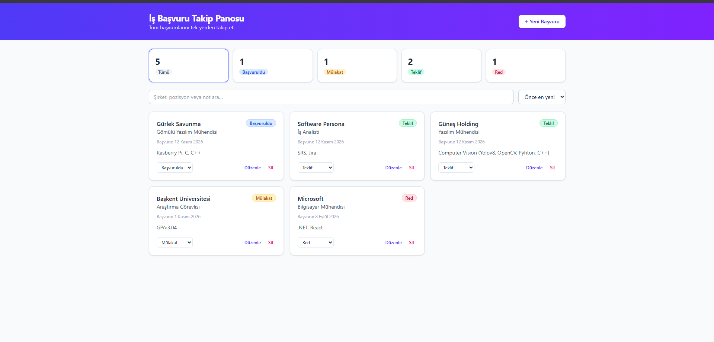

# İş Başvuru Takip Panosu

React (Vite) + TypeScript + Tailwind CSS ile geliştirilmiş iş başvuru takip uygulaması. Şirket, pozisyon, başvuru tarihi, durum (Başvuruldu, Mülakat, Teklif, Red) ve not bilgilerini tutar. Veriler tarayıcının **LocalStorage**'ında saklanır.

## Özellikler

- **Ekle / Listele / Güncelle / Sil** (tam CRUD)
- Duruma göre filtreleme (istatistik kartlarına tıklayarak)
- Şirket, pozisyon ve notlarda arama
- Tarihe göre sıralama
- Karttan hızlı durum değiştirme
- Sayfa yenilense de veriler kaybolmaz

## Klasör Yapısı

```
src/
├── Components/   # ApplicationCard, ApplicationForm, Header, Modal, StatsBar, Toolbar, ...
├── Pages/        # BoardPage
├── Interfaces/   # Application.ts (tipler)
└── hooks/        # useApplications (LocalStorage kalıcılığı)
```

## Kurulum

```bash
npm install
npm run dev      # geliştirme sunucusu
npm run build    # üretim derlemesi (dist/)
npm run preview  # derlemeyi yerelde önizle
```

## Netlify ile Yayınlama

`netlify.toml` ve `public/_redirects` hazırdır (build: `npm run build`, publish: `dist`, SPA yönlendirmesi).

1. Projeyi GitHub'a (public) yükle.
2. Netlify → *Add new site → Import from Git* ile repoyu seç. Bu proje bir alt klasörde ise *Base directory* olarak `job-application-tracker` gir.
3. Ayarlar `netlify.toml`'dan okunur; *Deploy* de.

## Ekran Görüntüsü




## Canlı Demo

Netlify linki: [_buraya ekle_](https://melodious-travesseiro-ab7d31.netlify.app/
)
